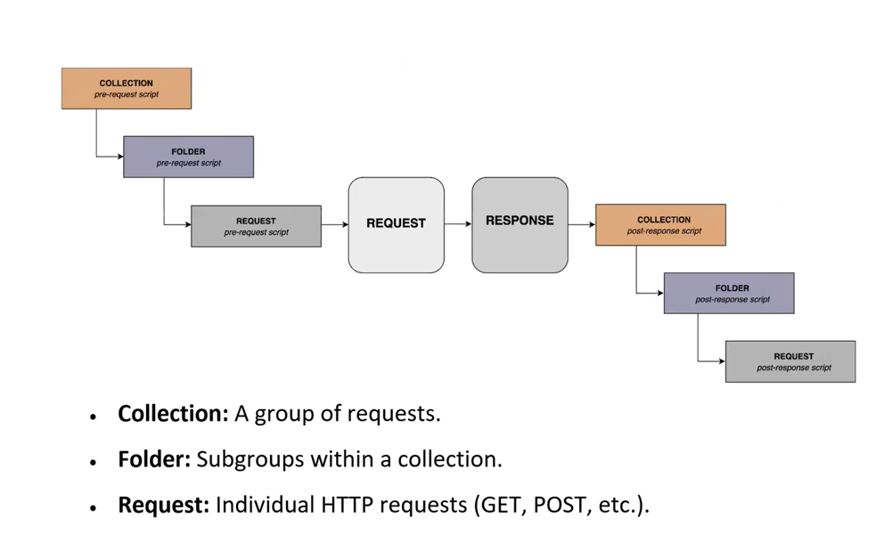
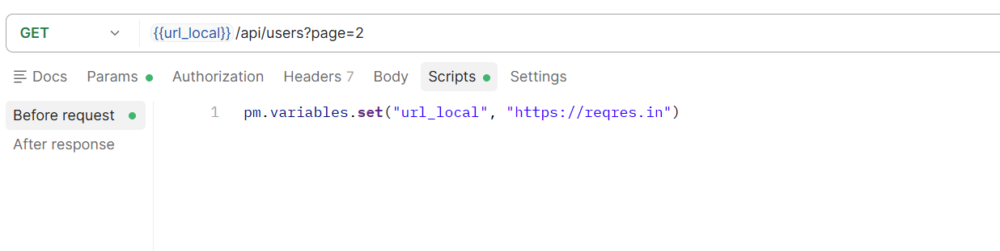
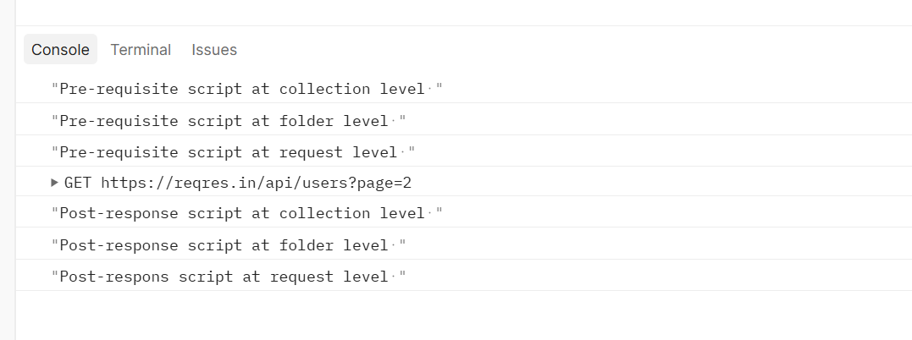
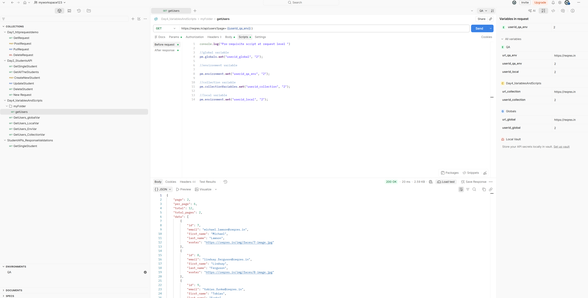

# API Testing
* Presentation Layer (GUI)
* Application Layer
* Data Layer
* FOUR TYPES OF API:
 - Open APIs (Public APIs)
 - Internal APIs (Private APIs)
 - Partner APIs
 - Composite APIs (These combine multiple APIs into one call, allowing you to get data from different sources in a single request)
* If you place API in the production, you call it as a web service. **_** All web services are APIs but every APIs is not web service.**_**
* Whatever APIs are available in the internet, we call them as a web service.
* MICROSERVICE is a small functionality in the application.
* Microservices communicate each other via APIs.
* We have REST and SOAP APIs. SOAP APIs are older and very less companies are using.
* SOAP APIs are using only Xml format sending request and response.
* REST APIs--> JSON, XML, text format, HTML, CSV format.
* REST APIs are faster than SOAP APIs.
* Difference between HTTP and HTTPS: HTTP is not secured, actually your data is not secured. HTTPS-->your data is secured, encrypted.
* URI--> Uniform Resource Identifier
* URL--> Uniform Resource Locator
* URN-->Uniform Resource Name
* FEATURE: is the term used in manual testing to test some functionality.
* RESOURCE: is the term used in API Automation testing referring some functionality.
* PAYLOAD--> means **body** in the HTTP request and response message.
* C - Create -->POST
* R - Retrieve -->GET
* U - Update -->PUT
* D - Delete -->DELETE
* A collection is a group of requests.
* https://reqres.in/api/users?page=2
* HOW TO CREATE APIs:
 - NodeJS
 - NPM (comes with NodeJS)
 - JSON-server (C:\Users\niyaz>npm install -g json-server)
 * to create your own API: C:\Users\niyaz\Downloads\back_end testing>json-server --watch student.json)


# JSON (JavaScript Object Notation):
* JSON is a syntax for storing and exchanging data.
* Basically, it was designed for human-readable data interchange.
* JSON is text, written with JavaScript Object Notation.
* It has been extended from the JavaScript scripting language.
* The filename extension is .json.
* JSON Internet media type is application/json.
  


# JSON Data Types
1. String: A string in JSON is a sequence of characters enclosed in double quotes (""). It can include letters, numbers, spaces, and special characters.
2. Number: in JSON can be integers or floating-point (decimal) values. They do not require quotes.
3. Boolean: Boolean values can either be true or false. They represent binary states and are not enclosed in quotes (e.g. {"isStudent:true, "isEmployed": false}).
4. Null (e.g. {"middleName":null})
5. Array: An array is an ordered list of values. The values can be of any JSON data type (e.g., strings, numbers, objects, etc.). Arrays are enclosed in square brackets (`[]`).

**Example:**

```json
{
  "skills": ["Java", "Python", "Selenium"],
  "scores": [85, 90, 95]
}
```
6. Object :An object is a collection of key-value pairs enclosed in curly braces (`{}`). Keys are strings, and values can be any JSON data type.

**Example:**

```json
{
  "person": {
    "firstName": "John",
    "lastName": "Doe",
    "address": {
      "city": "New York",
      "zip": "10001"
    }
  }
}
```

* 7. Example Combining All Data Types**

Here is a more complex example that combines all JSON data types:

**Example:**

```json
{
  "name": "Alice",
  "age": 28,
  "isMarried": false,
  "children": null,
  "hobbies": ["reading", "traveling", "coding"],
  "address": {
    "city": "Los Angeles",
    "state": "California",
    "postalCode": "90001"
  },
  "scores": [95.5, 88.0, 76],
  "profileComplete": true
}
```

# JSON Example:
{
"Title": "The Cuckoo’s Calling",
"Author": "Robert Galbraith",
"Genre": "classic crime novel",
"Detail": {
   "Publisher": "Little Brown",
    "Publication_Year": 2013,
    "ISBN-13": 9781408704004,
    "Language": "English",
    "Pages": 494
       },
"Price": [
{
"type": "Hardcover",
"price": 16.65
},
{
"type": "Kindle Edition",
"price": 7.03
}
]
}

# JSON Path

* JSON Path is a query language for JSON data, similar to XPath for XML. 
* It allows you to navigate and extract specific data from a JSON document by specifying paths. 
* JSON Path uses a syntax that makes it easy to access elements, objects, arrays, and their nested components.

# JSON Path Syntax Overview

1. Dot Notation (.): Accesses child elements.
2. Bracket Notation ([]): Accesses array elements or specific keys.
3. Wildcard (*): Matches all elements.


{
 "store": {
   "book": [
     {
         "title": "Java Programming",
         "author": "John Doe",
         "price": 29.99,
         "categories": ["Programming", "Java"]
     },
     {
        "title": "Python Basics",
        "author": "Jane Smith",
        "price": 19.99,
        "categories": ["Programming", "Python"]
    }
],
"bicycle": {
    "type": "Mountain",
    "price": 499.99
  }
 }
}

* I want to access Mountain ---> $.store.bicycle.type
* I want to access Python Basics--> $.store.book[1].title


# Useful tools to generate and evaluate JSON Paths:

* https://jsonpathfinder.com/](https://jsonpathfinder.com/
* https://www.site24x7.com/tools/jsonpath-finder-validator.html
* https://jsonpath.com/


# 4. VALIDATING RESPONSE in POSTMAN & JS

* POSTMAN supports CHAI library assertions
* Chai Assertion Library

# Postman uses the Chai assertion library for writing tests. There are two syntaxes for defining tests:

Using Function Syntax:

pm.test("Test Name", function() {
// assertion;
});

Using Arrow Function Syntax:

pm.test("Test Name", () => {
// assertion;
});

# 1. VALIDATING STATUS CODE

Check for a specific status code:

pm.test("Status code is 200", () => {
pm.response.to.have.status(200);
});

Check for one of multiple status codes:

pm.test("Successful POST request", () => {
pm.expect(pm.response.code).to.be.oneOf([201, 202]);
});

Check status code text:

pm.test("Status code name has string", () => {
pm.response.to.have.status("Created");
});


# 2. VALIDATING HEADERS
Check if a header is present:
* pm.test("Content-Type header is present", () => {
  pm.response.to.have.header("Content-Type");
  });

# Check header value

* pm.test("Content-Type header is application/json", () => {
  pm.expect(pm.response.headers.get("Content-Type"))
  .to.eql("application/json; charset=utf-8");
  });

* pm.test("Content-Type header contains application/json", () => {
  pm.expect(pm.response.headers.get("Content-Type"))
  .to.include("application/json");
  });

# 3. VALIDATING COOKIES
# CHECK IF A COOKIE IS PRESENT:
* pm.test("Cookie 'language' is present", () => {
  pm.expect(pm.cookies.has('language')).to.be.true;
  });

# CHECK COOKIE VALUE:
* pm.test("Cookie language has value 'en-gb'", () => {
  pm.expect(pm.cookies.get('language')).to.eql('en-gb');
  });

# 4. VALIDATING RESPONSE TIME:
Check response time is below a threshold:

* pm.test("Response time is less than 200ms", () => {
  pm.expect(pm.response.responseTime).to.be.below(200);
  });


# 5. VALIDATING RESPONSE BODY
# CHECK VALUE TYPES

* SAMPLE EXAMPLE:
  {
  "id": 1,
  "name": "John",
  "location": "india",
  "phone": "1234567890",
  "courses": [
  "Java",
  "Selenium"
  ]
  }

* const jsonData = pm.response.json();
pm.test("Test data type of the response", () => {
pm.expect(jsonData).to.be.an("object");
pm.expect(jsonData.name).to.be.a("string");
pm.expect(jsonData.id).to.be.a("number");
pm.expect(jsonData.courses).to.be.an("array");
});


# Check array properties:
* pm.test("Test array properties", () => {
  pm.expect(jsonData.courses).to.include("Java");
  pm.expect(jsonData.courses).to.have.members(["Java", "Selenium"]);
  });


# CHECK SPECIFIC JSON FIELD DATA
pm.test("Validate specific fields in JSON response", () => {
var jsonData = pm.response.json();
pm.expect(jsonData.id).to.eql(1);
pm.expect(jsonData.name).to.eql("John");
pm.expect(jsonData.location).to.eql("india");
pm.expect(jsonData.phone).to.eql("1234567890");
pm.expect(jsonData.courses[0]).to.eql("Java");
pm.expect(jsonData.courses[1]).to.eql("Selenium");
});


# 6. SCHEMA VALIDATION ---->SCHEMA=METADATA
pm.test('Schema is valid', function() {
pm.expect(ajv.validate(jsonData, schema)).to.be.true;
});
* To be able to create a schema use https://www.liquid-technologies.com/online-json-to-schema-converter
* JSON SCHEMA:
  {
  "$schema": "http://json-schema.org/draft-04/schema#",
  "type": "object",
  "properties": {
  "id": {
  "type": "integer"
  },
  "name": {
  "type": "string"
  },
  "location": {
  "type": "string"
  },
  "phone": {
  "type": "string"
  },
  "courses": {
  "type": "array",
  "items": [
  {
  "type": "string"
  },
  {
  "type": "string"
  }
  ]
  }
  },
  "required": [
  "id",
  "name",
  "location",
  "phone",
  "courses"
  ]
  }

# POSTMAN SCRIPTS AND VARIABLES:

# TYPES OF VARIABLES IN POSTMAN 

A. Global Variable (Accessible everywhere, WORKSPACE LEVEL):
url_global = https://reqres.in

B. Environment Variable (Specific to an environment like QA or Prod, YOU CAN ACCESS IN EVERYWHERE BUT YOU SHOULD CHANE THE ENVIRONMENT):
url_qa_env = https://reqres.in

C. Collection Variable (Specific to a collection of requests):
url_collect = https://reqres.in

D. Local Variable (Specific to a single request):
url_local = https://reqres.in 

E. Data Variable (Values provided through CSV/JSON files in the collection runner [external variables]).

# Accessing Variables in URLs:
  Use {{variable_name}} to reference variables in the request URL.

Example:

{{url_global}}/api/users?page=2
{{url_qa_env}}/api/users?page=2
{{url_collect}}/api/users?page=2
{{url_local}}/api/users?page=2


# Postman Scripts

Postman scripts can be written at different stages:

1. Pre-request scripts: Run before the request is sent.
2. Post-response scripts: Run after receiving the response.

Workflow: Pre-request Script → Request → Response → Post-response

* Collection---->Folder---->Request

# EXECUTION HIERARCHY


* NOTE: We will create variables under Pre-requEST scripts!!!!!! **INTERVIEW QUESTION**--->Variables should be created before sending the request
* Assertions and validations will be created under POST-RESPONSE scripts!!!!IMPORTANT--->validations should be done after getting response!!!!!!!


* NOTE: If we create variables (for the all levels) on REQUEST level, they will be automatically created in other parents folder because REQUEST level is a child. 

 -//global variable
  pm.globals.set("userid_global", "2");

//environment variable

pm.environment.set("userid_qa_env", "2");

//collection variable
pm.collectionVariables.set("userid_collection", "2");

//local variable
pm.environment.set("userid_local", "2"); 